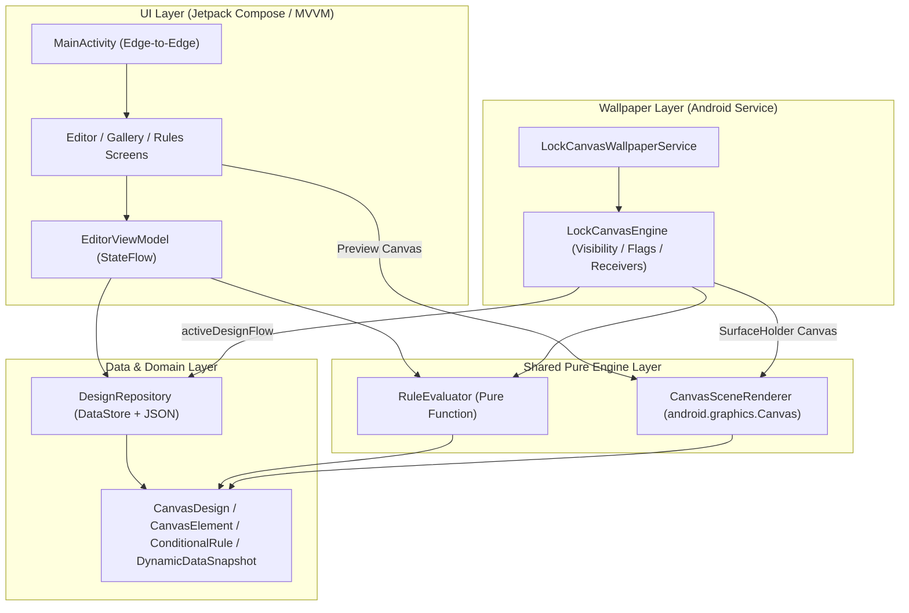

# LockCanvas 技術的実現可能性調査・MVP仕様・アーキテクチャ設計書

- **対象アプリ**: LockCanvas（Android ネイティブ ロック画面ライブ壁紙カスタマイズアプリ）
- **パッケージ名**: `com.lockcanvas.app`
- **ターゲット環境**: `compileSdk = 35` / `targetSdk = 35` / `minSdk = 26`（Android 14 / 15 / 16 および Pixel 端末の最新仕様を前提）
- **調査基準日**: 2026-11-23（Android 公式ドキュメント `developer.android.com` をもとに検証）

---

## 1. 技術的な実現可能性と制約の整理

Android 標準 API（非 root / 非システム権限 / Google Play 準拠）の範囲で、ロック画面のカスタマイズをライブ壁紙（`WallpaperService`）で実現する場合の可否と制約を整理する。

### 1.1 実現可能性マトリクス

| 領域・機能 | 判定 | 技術的根拠・制約 | 推奨する代替案・設計方針 |
| :--- | :---: | :--- | :--- |
| **ライブ壁紙としてのロック画面描画** | **実現可能** | `WallpaperService` / `WallpaperService.Engine` の `SurfaceHolder`（`Canvas` / `lockHardwareCanvas()`）で自由な2D描画・テキスト・図形・画像・軽量アニメーションが可能。 | エディタと壁紙サービスで描画エンジン（`CanvasSceneRenderer`）を共有し、WYSIWYG を実現する。 |
| **動的データ表示（時刻・日付・バッテリー・充電状態）** | **実現可能** | `ACTION_TIME_TICK`・`ACTION_TIME_CHANGED`・`ACTION_BATTERY_CHANGED` は特別な危険権限なしで取得可能。 | `Engine` 可視時のみ動的レシーバを購読し、イベント駆動で再描画する。 |
| **条件ルールによる見た目切替（低バッテリー・充電中・夜間など）** | **実現可能** | ローカル状態（時刻・バッテリー等）を純粋関数で評価して描画プロパティを上書き可能。 | `RuleEvaluator` によりデザイン定義を非破壊で評価し、リアルタイム反映する。 |
| **ロック画面のみへのライブ壁紙適用** | **制限あり** | サードパーティアプリは `WallpaperManager.ACTION_CHANGE_LIVE_WALLPAPER` で OS の壁紙ピッカーを開くことしかできず、`FLAG_LOCK` 単独指定のサイレント適用は不可（`FLAG_LOCK` 直接指定 API は静止画 `setBitmap`/`setStream` のみ）。Android 14+ の Pixel 等では OS ピッカー側で「ロック画面のみ／両方」を選択できるが、OEM により「ホームとロック画面の両方」固定になる場合がある。 | Android 14+（API 34+）では `Engine.getWallpaperFlags()` / `onWallpaperFlagsChanged(flags)` で `FLAG_LOCK` と `FLAG_SYSTEM` を判別し、描画内容を出し分ける。適用画面では OS ピッカーの選択手順を明示案内する。 |
| **OS 標準時計・通知・指紋アイコンとの干渉回避** | **制限あり** | 標準 API では OS 側のロック画面時計・通知カード・指紋認証アイコンを非表示・移動できない。 | エディタ上に **OS セーフエリアガイド**（上部時計・中央通知・下部指紋/ショートカット領域）を表示し、被りを避けたレイアウトを支援する。また `onComputeColors()` で適切な `WallpaperColors` を返し、OS 文字色の視認性を保つ。 |
| **ロック画面上でのタッチ操作（ボタン・ウィジェット操作）** | **標準APIでは不可** | ロック画面表示中は SystemUI（Keyguard）が最前面でタッチをインターセプトするため、`setTouchEventsEnabled(true)` を設定しても `Engine.onTouchEvent()` はロック画面では安定して届かない（ホーム画面でのみ動作）。 | ロック画面は**「見る・状態変化を楽しむ（非インタラクティブ／イベント駆動）」**体験に特化する。編集・切替はアプリ本体または（将来的に）クイック設定タイル／ホームウィジェット等で行う。 |
| **Always-on Display (AOD) 上での連続描画・アニメーション** | **標準APIでは不可** | AOD は OS（SystemUI / コンポジタ）が省電力・焼き付き防止のため直接管理しており、サードパーティのライブ壁紙は画面オフ／Doze 移行時に `onVisibilityChanged(false)` となり描画停止・暗転・静止化される。 | AOD 非対応を仕様として明記し、画面点灯時（ロック画面表示時）の滑らかな復帰描画に最適化する。`onVisibilityChanged(false)` で必ずループを停止する。 |
| **外部データ連携（天気・歩数・メディア・カレンダー）** | **制限あり** | 位置情報・ネットワーク・ランタイム権限・通知アクセスなど権限要件と Play ポリシー制約がある（1.6 節参照）。 | MVP では権限不要な時刻・日付・バッテリーに絞り、外部データは Phase 3 以降でオプトイン＋キャッシュ設計（`WorkManager` 等）として段階導入する。 |

---

### 1.2 `WallpaperService` / `WallpaperService.Engine` の描画範囲と `FLAG_LOCK` / `FLAG_SYSTEM`

- **描画サーフェス**: `Engine` は `SurfaceHolder` を通じてフルスクリーン相当の描画領域を受け取る。`onSurfaceChanged(holder, format, width, height)` で実ピクセル寸法を取得し、正規化座標（`0f..1f`）ベースで配置することで解像度・アスペクト比の違いを吸収する。
- **複数 Engine インスタンス**: システムは「現在適用中の壁紙」と「壁紙ピッカーのプレビュー」で同時に複数の `Engine` を生成することがある。`isPreview()` でプレビュー動作を判別し、状態（レンダーループ・レシーバ）は必ず `Engine` インスタンス単位で独立管理する。
- **ロック画面 vs ホーム画面の判別（Android 14 / API 34+）**:
  - `Engine.getWallpaperFlags()` および `Engine.onWallpaperFlagsChanged(flags: Int)` が API 34 で導入された。
  - `flags and WallpaperManager.FLAG_LOCK != 0` でロック画面向け、`flags and WallpaperManager.FLAG_SYSTEM != 0` でホーム画面向けかを判定できる。
  - API 26〜33（Android 8.0〜13）ではフラグ判別 API がないため、`KeyguardManager.isKeyguardLocked` 等の補助判定を用いるか、共通デザインを描画するフォールバック設計とする。

### 1.3 ロック画面でのタッチイベント制約

- `WallpaperService.Engine` は `setTouchEventsEnabled(true)` によりホーム画面でのタッチ（`onTouchEvent`）や `onCommand(WallpaperManager.COMMAND_TAP)` を受信できる。
- しかし、**ロック画面（Keyguard）表示中は SystemUI がロック解除・通知操作・ショートカット・生体認証のためタッチイベントを消費する**ため、壁紙レイヤーには信頼性をもって届かない。
- そのため LockCanvas では、ロック画面上のタップ依存機能（ボタン押下やドラッグ操作）を設計に含めず、**状態変化（時刻・充電・バッテリー残量・ルール条件）に自動応答するキャンバス**として体験を設計する。

### 1.4 Pixel 端末特性・Always-on Display (AOD) 制約

- **Pixel（AOSP 準拠の厳格な SystemUI）**: Samsung One UI のような OEM 独自ロック画面フックは存在せず、標準 API の仕様通りに動作する。
- **AOD（常に表示）**: 画面消灯〜AOD 状態ではシステムが低消費電力レンダリングへ移行し、サードパーティのライブ壁紙による連続フレーム更新は抑止される。AOD 中に無理に CPU を起こし続ける実装（Wakelock 等）はバッテリー異常消費警告の対象となるため禁止する。
- **セーフエリアの目安（Pixel 縦画面）**:
  - 上部約 `10%〜32%`: ステータスバーおよび OS 標準ロック画面時計（大型時計設定時は中央付近まで拡大）
  - 中央部: 通知スタック表示領域
  - 下部約 `78%〜96%`: 画面内指紋認証センサーアイコンおよび左右ショートカット

### 1.5 Android 14 / 15 / 16 における主要プラットフォーム制約

1. **Edge-to-edge の強制化（Android 15 / 16）**:
   - `targetSdk = 35`（Android 15）では Edge-to-edge がデフォルト強制される。
   - Android 16（API 36）では一時的なオプトアウト属性（`windowOptOutEdgeToEdgeEnforcement`）も非推奨・無効化されるため、初期構築時点から `enableEdgeToEdge()` と Jetpack Compose の `WindowInsets`（`Scaffold` / `safeDrawingPadding` / `navigationBarsPadding`）で完全対応する。
2. **動的 `BroadcastReceiver` のエクスポートフラグ必須化（Android 14+）**:
   - `targetSdk >= 34` では `Context.registerReceiver()` 呼び出し時に `RECEIVER_EXPORTED` または `RECEIVER_NOT_EXPORTED` の明示が必須（未指定は `SecurityException`）。
   - `ACTION_TIME_TICK` や `ACTION_BATTERY_CHANGED` などのシステムブロードキャスト受信には `ContextCompat.registerReceiver(..., ContextCompat.RECEIVER_NOT_EXPORTED)` を使用する。
3. **Photo Picker（`PickVisualMedia`）と URI 永続化（Android 13〜16）**:
   - ユーザー画像の選択には `ActivityResultContracts.PickVisualMedia` を採用し、`READ_MEDIA_IMAGES` / `READ_EXTERNAL_STORAGE` などの広範なストレージ権限を不要とする。
   - **重要な注意点**: Photo Picker が返す `content://` URI は端末再起動やアプリ再インストール（Android 16 の URI 権限リセット含む）で読み取り権限が失効する場合がある。ライブ壁紙サービスから常時安定して読み込むため、**選択時に画像をアプリ専用内部ストレージ（`filesDir/canvas_images/`）へ適度な解像度でコピー保存**する運用を推奨する。
4. **バックグラウンド実行・フォアグラウンドサービス（FGS）制限（Android 14 / 15）**:
   - Android 14 で `foregroundServiceType` と専用権限が必須化され、Android 15 では `dataSync` / `mediaProcessing` に 24 時間合計 6 時間の上限や `BOOT_COMPLETED` からの起動制限が課された。
   - **`WallpaperService` の位置づけ**: システムから `BIND_WALLPAPER` でバインドされるサービスであり、通常の FGS とは異なり常駐通知なしで動作する（Background Execution Limits の特例対象）。
   - ただし、壁紙サービス内から独自に FGS を起動してはならない。将来の天気更新など定期バックグラウンド処理はすべて **`WorkManager`** に委譲し、ローカル（DataStore 等）へキャッシュした値を壁紙側が読む構成にする。

### 1.6 データソース別の実現可能性と権限・運用整理

| データソース | 実現性 | 必要な権限・API | 取得方式・注意点 | 導入フェーズ |
| :--- | :---: | :--- | :--- | :---: |
| **時計・日付** | 実現可能 | 権限不要（`ACTION_TIME_TICK`, `ACTION_TIME_CHANGED`, `ACTION_TIMEZONE_CHANGED`） | 動的登録のみ（Manifest 静的登録不可）。1分単位の更新で省電力。秒表示は可視時のみ 1Hz 更新に限定。 | **Phase 1 (MVP)** |
| **バッテリー・充電状態** | 実現可能 | 権限不要（`ACTION_BATTERY_CHANGED` Sticky Broadcast / `BatteryManager`） | 動的登録でリアルタイム変化を受信。初期値は `registerReceiver(null, IntentFilter(ACTION_BATTERY_CHANGED))` で同期取得可能。 | **Phase 1 (MVP)** |
| **天気** | 制限あり | `INTERNET` ＋ 任意で `ACCESS_COARSE_LOCATION`（または手動都市指定） | 外部天気 API キー・レート制限管理が必要。`WorkManager` で 30〜60 分間隔キャッシュし、壁紙から直接通信しない。 | Phase 3 |
| **歩数** | 制限あり | `ACTIVITY_RECOGNITION`（ランタイム権限、API 29+）＋ `SensorManager` (`TYPE_STEP_COUNTER`) または Health Connect | `TYPE_STEP_COUNTER` は端末再起動でリセットされるため日次差分の永続化が必要。未許可時はフォールバック表示。 | Phase 3 |
| **カレンダー（次の予定）** | 制限あり | `READ_CALENDAR`（危険なランタイム権限）＋ `CalendarContract` | プライバシー配慮のため「予定タイトルをロック画面に出すか」の明示オプトインとマスク設定を推奨。 | Phase 3 |
| **メディア再生情報** | 制限あり | `NotificationListenerService`（システム設定での手動「通知アクセス」許可）＋ `MediaSessionManager.getActiveSessions` | 権限の心理的ハードルが高く、Google Play 審査でも利用目的の明確な説明が求められる。必須機能にせず完全オプトインとする。 | Phase 3 |

### 1.7 省電力・メモリ・視認性ベストプラクティス

- **非可視時の完全停止**: `onVisibilityChanged(false)` を受けたら、アニメーション用コルーチン／`Choreographer`／`Handler` を即座にキャンセルし、不要な動的レシーバも解除する。
- **イベント駆動 ＋ 低 FPS スロットル**:
  - 静的デザイン（`AnimationStyle.NONE`）ではループを回さず、**可視化時・デザイン変更時・時刻/バッテリー変化時のみ 1 フレーム描画**する（実質 0 FPS アイドル）。
  - 軽量アニメーション有効時（`FLOATING_PARTICLES` / `PULSE_GLOW`）でも 20〜30 FPS 程度へスロットルし、GPU/CPU 負荷と発熱を抑える。
- **ハードウェアアクセラレーション描画**: `minSdk = 26` のため、`SurfaceHolder.lockHardwareCanvas()` を優先使用し（失敗時のみ `lockCanvas()` へフォールバック）、GPU オフロードで滑らかさと省電力を両立する。
- **ビットマップキャッシュと解像度制限**: 画像要素は表示サイズに合わせてサンプリング読み込み（`inSampleSize`）し、LRU キャッシュ等で保持して毎フレームのデコードと GC スパイクを防ぐ。
- **`WallpaperColors` / `onComputeColors()` の最適化**:
  - デザインの背景色・アクセント色から `WallpaperColors` を算出しキャッシュする。毎フレーム再計算せず、デザイン変更時のみ `notifyColorsChanged()` を呼ぶことで、OS の Material You 配色とロック画面時計のコントラスト（白/黒文字自動切替）を適切に保ちつつ省電力化する。

---

## 2. MVP の仕様（Phase 1 技術検証 ＋ Phase 2/3 基盤）

### 2.1 コンセプト

> **「権限ゼロ・省電力で、ロック画面を自分だけの動的キャンバスに変える」**

OS のロック画面制約（タッチ不可・AOD 不可・OS 標準時計との共存）を前提に受け入れたうえで、**「開くたびに美しい」「バッテリーや時間帯に応じて表情が変わる」「編集画面と実機ロック画面が完全一致する」**体験を最小構成で成立させる。

### 2.2 MVP（Phase 1）実装スコープ

1. **キャンバスエディタ（Jetpack Compose + Material 3）**
   - ライブプレビュー（壁紙と同じ `CanvasSceneRenderer` を描画）
   - 要素の追加・選択・ドラッグ移動・サイズ/スケール/透明度/色/テキスト編集・削除
   - **OS セーフエリアガイド表示切替**（時計・通知・指紋エリアの目安枠をオーバーレイ表示）
   - 背景設定（単色 / 2色グラデーション）と軽量アニメーション選択（`NONE` / `FLOATING_PARTICLES` / `PULSE_GLOW`）
2. **サポートする要素（`CanvasElement`）**
   - `TextElement`: 任意テキスト＋動的トークン展開（`{time}`, `{date}`, `{battery}`, `{charging_status}`）、フォントサイズ、太字、色
   - `BatteryGaugeElement`: バッテリー残量ゲージ（`BAR` / `CIRCULAR`）、色、ラベル表示切替
   - `ShapeElement`: 図形（`RECTANGLE` / `CIRCLE` / `PILL`）、塗り・枠線・角丸（背景カードや装飾フレーム用途）
   - `ImageElement`: Photo Picker で選択した画像の配置・角丸・サイズ調整
3. **条件ルールエンジン（`ConditionalRule`）**
   - 条件（`RuleCondition`）: `BatteryBelow(thresholdPercent)` / `IsCharging` / `NightTime(startHour, endHour)`
   - アクション（`RuleAction`）: `OverrideBackground` / `OverrideElementText` / `ToggleElementVisibility`
   - ルールの ON/OFF 切替、エディタ上でのシミュレーション（例: バッテリー残量・充電状態・時刻のテスト切替）
4. **デザイン管理・プリセット**
   - 初期プリセット 3 種（`Minimal Clock & Battery`, `Cyber Neon Gauge`, `Night Zen Canvas`）— OS 時計と指紋領域を避けた安全配置
   - デザインの保存・複製・削除・アクティブ切替（DataStore へ JSON 永続化）
5. **ライブ壁紙適用＆反映（`LockCanvasWallpaperService`）**
   - `ACTION_CHANGE_LIVE_WALLPAPER` によるワンタップ壁紙ピッカー起動
   - DataStore の `activeDesignFlow` を購読し、エディタで保存・切替したデザインをロック画面へ即時反映
   - 動的データ（時刻・日付・バッテリー・充電状態）の自動更新とルール評価

### 2.3 MVP で意図的に除外する範囲

- AOD（Always-on Display）上の独自描画（OS 制約により不可）
- ロック画面上でのタッチ操作・ウィジェットボタン（Keyguard 制約により不可）
- 天気・歩数・カレンダー・メディア連携（権限・外部 API・審査要件のため Phase 3 へ分離）
- クラウド同期・アカウント管理・デザインマーケット・課金機能

### 2.4 実機検証チェックリスト（Phase 1 完了基準）

- [ ] Pixel 実機（Android 14 / 15 / 16）で `ACTION_CHANGE_LIVE_WALLPAPER` からロック画面へ適用できる
- [ ] 画面消灯 → 点灯時に、現在の時刻・バッテリー・充電状態が正しく描画される
- [ ] 充電ケーブル挿抜・バッテリー残量変化・条件ルール（例: 充電中背景変更）がロック画面へ反映される
- [ ] エディタで要素移動・保存後、ロック画面へ戻ると即時反映されている
- [ ] 画面オフ／他アプリ遷移時に `onVisibilityChanged(false)` で描画ループが完全停止し、バッテリー異常消費がない
- [ ] Edge-to-edge 環境でエディタ UI がステータスバー・ナビゲーションバーと重ならない

---

## 3. 推奨アーキテクチャ

### 3.1 技術スタック

- **言語**: Kotlin（Coroutines / Flow）
- **UI**: Jetpack Compose + Material 3（Edge-to-edge 対応）
- **壁紙レンダリング**: Android `WallpaperService` + `android.graphics.Canvas`（`lockHardwareCanvas()` 優先）
- **状態永続化**: Jetpack DataStore (`datastore-preferences`) + `kotlinx.serialization`（JSON）
- **アーキテクチャパターン**: 単方向データフロー（MVVM / UDF）＋ 純粋関数エンジン層

### 3.2 レイヤー構成とパッケージ設計

| パッケージ | 責務 | 主なクラス |
| :--- | :--- | :--- |
| `com.lockcanvas.app.model` | シリアライズ可能なドメインモデル・初期プリセット | `CanvasDesign`, `CanvasElement` (`TextElement`, `BatteryGaugeElement`, `ShapeElement`, `ImageElement`), `ConditionalRule`, `DynamicDataSnapshot`, `PresetDesigns` |
| `com.lockcanvas.app.data` | デザイン永続化・アクティブデザイン管理 | `DesignRepository` |
| `com.lockcanvas.app.engine` | ルール評価と 2D キャンバス描画（UI・壁紙で完全共有） | `RuleEvaluator`, `CanvasSceneRenderer` |
| `com.lockcanvas.app.wallpaper` | `WallpaperService` 実装、可視性・システムブロードキャスト・`WallpaperColors` 管理 | `LockCanvasWallpaperService` |
| `com.lockcanvas.app.ui` | Compose 画面群、ViewModel、テーマ、Photo Picker 連携 | `MainActivity`, `EditorViewModel`, エディタ／ギャラリー／ルール画面 |

### 3.3 共通レンダリングパイプライン（WYSIWYG 設計）

- エディタプレビュー（Compose `Canvas` 内の `drawIntoCanvas { it.nativeCanvas }`）と、`LockCanvasWallpaperService`（`SurfaceHolder.lockHardwareCanvas()`）の**双方が同一の `CanvasSceneRenderer.drawScene(...)` を呼び出す**。
- 座標・サイズをすべて画面幅/高さに対する割合（`xFraction`, `yFraction`, `widthFraction`, `heightFraction`）で定義することで、プレビュー枠と実機フルスクリーン間のズレを防ぐ。
- `RuleEvaluator.evaluate(design, snapshot)` を副作用のない純粋関数とすることで、単体テスト容易性とエディタ上のルールシミュレーション機能を同時に確保する。

### 3.4 状態管理とデータ永続化

- **単一情報源（Single Source of Truth）**: `DesignRepository` が DataStore 上にデザイン一覧と `activeDesignId` を JSON 保存し、`designsFlow` / `activeDesignFlow` を公開する。
- **プロセス内即時同期**: エディタと `WallpaperService` は同一アプリプロセスで動作するため、DataStore への書き込みが `activeDesignFlow` 経由で `LockCanvasWallpaperService` へ即座に伝播し、再適用操作なしで壁紙が更新される。
- **画像アセット管理**: Photo Picker で取得した URI は永続権限が切れるリスクがあるため、アプリ内部ストレージへリサイズコピーしたパス／URI を `ImageElement.uriString` に保持する設計を標準とする。

---

## 4. 次の開発ステップ（Phase 2〜4）

### Phase 2: 表現力と編集体験の洗練
- **エディタ操作性向上**: ピンチ拡大縮小、2本指回転、グリッド／中央スナップガイド、Undo/Redo、レイヤー順序（`zIndex`）並べ替え UI
- **デザイン表現拡張**: フォント選択（システム／バンドルフォント）、テキスト影・縁取り、グラデーション角度設定、追加アニメーション（波紋・オーロラ・ミニマル時計針）
- **ホーム vs ロック画面の出し分け（Android 14+）**: `getWallpaperFlags()` を活用し、ロック画面とホーム画面で別デザインまたは簡易モードを割り当てるオプション

### Phase 3: 動的データソースの段階的拡張（すべてオプトイン）
- **天気データ**: `WorkManager` による定期取得＋ローカルキャッシュ（手動都市設定を既定とし、位置情報は任意権限）
- **歩数データ**: `ACTIVITY_RECOGNITION` 許可時のみ `TYPE_STEP_COUNTER` 日次集計を表示
- **カレンダー予定**: `READ_CALENDAR` 許可時のみ直近 1 件の予定時刻・タイトル（ロック画面向けプライバシーマスク対応）を表示
- **メディア再生情報**: `NotificationListenerService` 許可時のみ再生中トラック名・アーティスト名を表示（専用オンボーディング説明付き）
- **条件ルール拡張**: 天気連動（雨天時テーマ変更）、時間帯グラデーション、通知有無に応じた演出など

### Phase 4: 品質仕上げ・配布準備
- **性能・省電力検証**: Android Studio Profiler / Battery Historian による実機計測（非可視時 CPU 0%、描画フレーム時間・メモリ使用量の確認）
- **多言語・アクセシビリティ対応**: 日本語／英語の文言整備、TalkBack ラベル、コントラスト検証
- **エクスポート／共有**: `CanvasDesign` JSON の書き出し・読み込みによるテンプレート共有
- **Google Play 公開準備**: プライバシーポリシー、データセーフティ申告、スクリーンショット、権限利用説明の整備（ストア審査要件チェック）
